# Lab 3 · Persistance MySQL avec Spring Boot

API REST en Java 21 avec Spring Data JPA, Hibernate et MySQL. Une catégorie regroupe plusieurs produits. Une commande contient plusieurs lignes, chacune liée à un produit.

## Démarrer

1. Installer Java 21, Maven et Docker avec le module Compose.
2. Définir la variable d’environnement `DB_PASSWORD` dans le terminal de lancement.
3. Lancer `docker compose up -d --wait` à la racine.
4. Lancer `mvn spring-boot:run`. L’API écoute sur `http://localhost:8080`.

Hibernate crée les tables. Pour un serveur MySQL existant, exécuter `src/main/resources/db/create-database.sql` avec un compte administrateur, puis fournir `DB_URL`, `DB_USER` et `DB_PASSWORD` pour un compte autorisé sur la base. Le script `demo-data.sql` peut être exécuté après la création des tables.

## Tester

Importer `Lab3-API.postman_collection.json` et lancer les requêtes dans l’ordre. La collection récupère les identifiants créés au fil de l’exécution. Elle couvre le CRUD produit, la pagination et le tri, les commandes, la validation et le refus de supprimer un produit déjà commandé.

| Ressource | Routes |
|---|---|
| Catégories | GET et POST /api/categories, GET /api/categories/{id} |
| Produits | GET et POST /api/products, GET, PUT et DELETE /api/products/{id} |
| Produits d’une catégorie | GET /api/categories/{id}/products ou GET /api/products?categoryId=1&page=0&size=10&sort=price,desc |
| Commandes | GET et POST /api/orders, GET /api/orders/{id} |

Les réponses exposent des DTO et des identifiants de relation. L’enregistrement de la commande et de ses lignes se fait dans une transaction. Le prix unitaire est conservé dans la ligne au moment de la commande. Une suppression de produit référencé renvoie HTTP 409.

## Vérification réalisée

Le JAR compilé avec Maven a été lancé avec H2 sur fichier en mode de compatibilité MySQL. Les 12 requêtes et les 20 assertions Newman ont réussi. Après un redémarrage du serveur, une requête GET a retrouvé la commande et sa ligne. Le démarrage avec MySQL 8.4 reste à vérifier sur une machine qui autorise le socket du serveur MySQL.

- [Sortie réelle de Newman](docs/newman.txt)
- [Réponse HTTP après redémarrage](docs/redemarrage.txt)

## Preuves d’exécution

13 visuels tirés des sorties réelles de Newman et de curl. La base utilisée pour ces essais est H2 sur fichier en mode de compatibilité MySQL.

### 1. Créer une catégorie

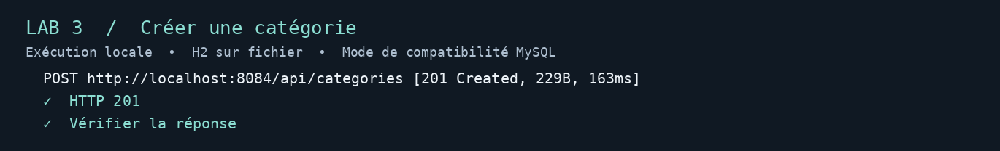

### 2. Créer un produit

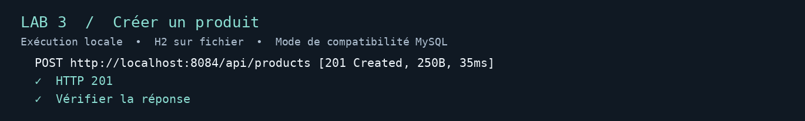

### 3. Lire le produit

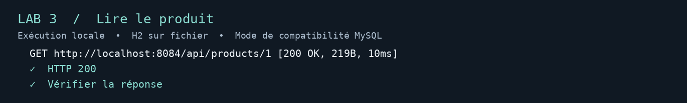

### 4. Filtrer et trier

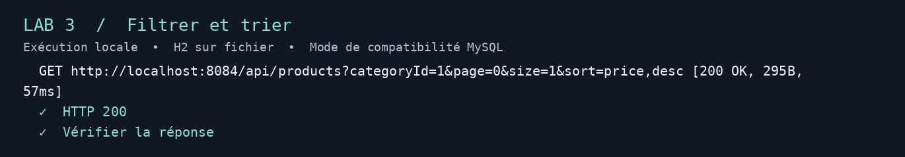

### 5. Modifier le produit

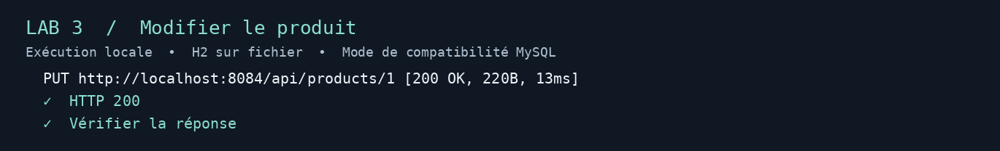

### 6. Créer une commande

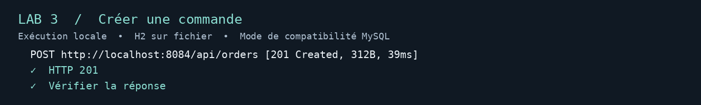

### 7. Lire la commande

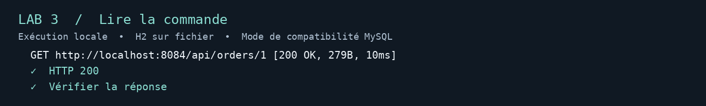

### 8. Refuser une ligne invalide

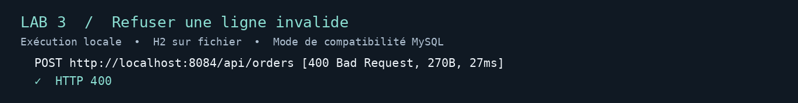

### 9. Protéger une ligne de commande

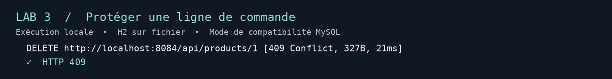

### 10. Créer un produit temporaire

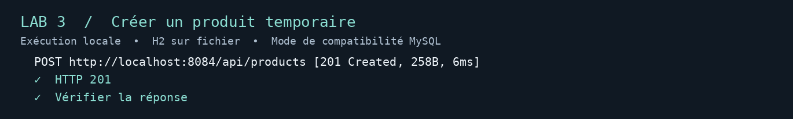

### 11. Supprimer le produit temporaire

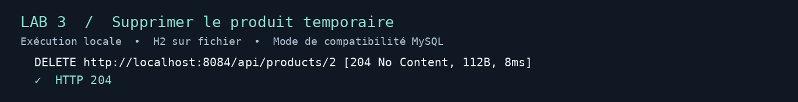

### 12. Vérifier le produit absent

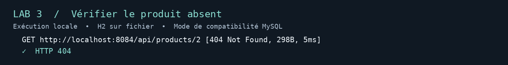

### 13. Relire la commande après redémarrage

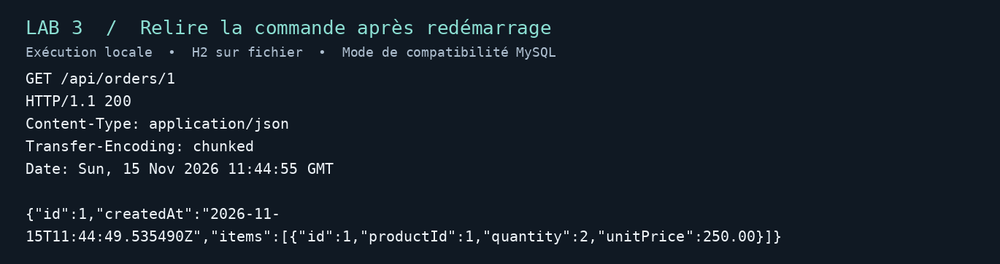
